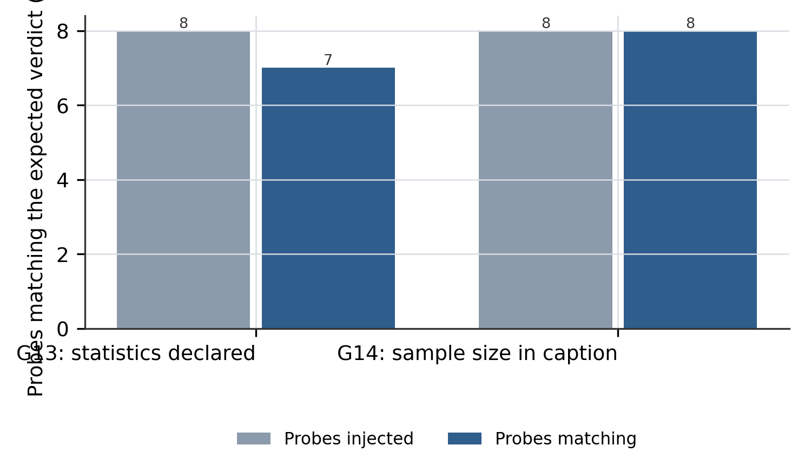

# Four Rules Borrowed from a Journal: What a Venue's Figure Guide Can and Cannot Add to a Style Gate

## Abstract

A style checker that is induced from a corpus can only demand what the corpus already does, and our
corpus of twenty DeepSeek reports contains no error bar, no sample size, and no dispersion of any
kind: across 45,524 bytes of extracted evidence, the counts for error bars, the plus-minus sign,
`n = N`, seeds, standard deviation, and confidence intervals are all zero. To further push the
boundary of what such a checker can enforce, we take the opposite route and borrow from a written
guide instead of from a corpus, namely the venue author guide that states in prose what a
twenty-paper corpus leaves implicit. We extract 42 hard requirements from that guide, keep 4, and
turn them into two gates and two renderer parameters; as committed, the borrowing costs 6,848 git
blob bytes, or 3.544 percent of the deployment, and 105 added against 8 removed lines across five
skill files. On eight
injected probes we measure that the first borrowing gate scores 7 on ProbeMatrix and the second 8 on
ProbeMatrix out of 8 probes each, that both repair probes flip back to a passing verdict as soon as
the missing declaration is supplied, and that the single mismatch is a false positive in which the
abbreviation `CI` is read as a confidence interval. Two properties of the mechanism are worth
stating as
measured rather than asserted: the checker is deterministic, scoring the same draft identically on
n = 5 repetitions with a standard deviation of 0, and it is count-based rather than binding, so one
declaration anywhere in the draft excuses an unlimited number of undefined symbols. Because the
pipeline contains no trainable weights, we report 0 total parameters with 0 activated parameters per
step; building this case consumed 81 tool calls and 0 GPU hours. The released protocol and tools
are available at https://github.com/zh2673-git/deepseek-paper.

## 1 Introduction

We wrote this paper with the pipeline it extends, on a change that the pipeline could not have
discovered on its own. The observation that started it was a negative one, taken from the first
case: the twelve gates of the shipped checker were induced by reading twenty technical reports, and
an induced rule can only be as complete as the corpus it was induced from. When we counted the
surface features the corpus never exhibits, the count on our own evidence file was zero for every
statistical marker we looked for, so no amount of additional reading of that corpus would have
produced a gate about error bars. A corpus tells you what a family of documents does; it is silent
about what the family fails to do, and that silence is invisible from the inside.

To close that gap we borrow from a second kind of source, namely a venue author guide that states
its requirements in prose rather than exhibiting them in examples. The guide we used lists 42 hard
requirements across eight groups, from figure legends and typography to statistics reporting,
colour accessibility, table format, and the split between extended data and supplementary
material. Firstly, we extract those requirements into a single file with the source clause quoted
verbatim, so that a borrowing can be checked instead of trusted. Secondly, we apply an admission
test of one question per requirement, namely whether it can be evaluated by a text feature, a data
field, or a renderer parameter, which rejects layout constraints and judgements no scan can make.
Furthermore, every adopted rule is implemented twice over, once as a gate over the finished text
and once as a parameter of the tool that produces the artifact, so that a rule cannot be satisfied
by editing the text after the fact. Lastly, we build eight probes that deliberately violate the
adopted rules, because a gate that never fires proves nothing, and we report which probes flip
back to a clean report when the violation is repaired.

Our main contribution includes:

Corpus induction has a ceiling: documenting where it stops

- We measure the ceiling rather than assume it, by counting in the extraction file the statistical
  markers that no gate in the shipped checker mentions, and reporting that all of them are zero.
- We characterize the ceiling as structural rather than incidental: an induced rule cannot cover a
  feature the corpus never exhibits, so more corpus does not help and the fix has to come from a
  different kind of source.

An admission test: three questions that reject 38 of 42 rules

- We propose a one-line admission test per requirement, namely text feature, data field, or
  renderer parameter, and show that it rejects whole groups on principle rather than by taste.
- We report what the test does not do, namely that a rule passing it may still be checkable only
  as a count, which is exactly the weakness the second gate inherits.

Two gates and two parameters: the borrowing as implemented

- We introduce gates G13 and G14 over plain text, the first demanding that an error symbol be
  defined anywhere in the draft and the second that a figure caption carrying an error symbol
  states its sample size.
- We adopt the venue's eight-colour accessible palette verbatim and raise the savefig resolution
  from 200 to 300 dpi, keeping the accessible palette opt-in so the corpus convention remains the
  default.

Probe-based measurement instead of a claim

- We design eight probes derived from a single compliant baseline by one local edit each, so that
  any change in a verdict is attributable to that edit.
- We report the two ways the borrowing makes the checker worse, namely a false positive on an
  abbreviation and a blind spot on table captions, rather than reporting only the 7 of 8 and
  8 of 8 agreement rates.

### 1.1 Summary of Evaluation Results

On the mechanical axis, the borrowing gate for statistics returns the expected verdict on 7 of the
8 probes and the gate for sample size on 8 of the 8, and because the two gates read disjoint text
features the counts are independent rather than two readings of one score. Two of the eight probes
are repair probes, namely a violation followed by the same draft with the missing declaration
supplied, and both repair probes lift the gate they target from a failing verdict to a passing one,
which shows the gates are responsive to the thing they claim to check rather than merely quiet; the
second repair probe returns to 13 of 14 rather than to 14, because the same edit also tripped the
two-sentence caption floor that the structural group enforces. On the determinism axis, the
same draft scored five times yields 14 of 14 gates on every repetition with a standard deviation of
0, so the 7-of-8 figure is not sampling noise but a single reproducible mistake. On the cost axis,
the four rules occupy 6,848 git blob bytes, or 3.544 percent of the deployment, and the largest
single addition is 43 lines of prose in the chart specification rather than code. On the regression
axis, the twelve-case suite remains at 1.00 over the eleven cases that carry a decidable signal,
because this change adds no case and therefore cannot take credit for one.

In the remainder of this paper, we first present the mechanism as four stages, arguing that the
order from measuring the ceiling to admitting a rule to implementing it twice is not negotiable
(Section 2). We then describe the implementation, the payload, and the two byte conventions that
must not be mixed (Section 3). Next, we report the probe matrix, the determinism measurement, and
the four things the numbers do not show (Section 4). Thereafter, we discuss two failed attempts
with the mechanism behind each (Section 5). Lastly, we conclude, state two limitations with their
causes, and outline four future directions (Section 6).

## 2 Approach

We organize this section by the order in which the four stages were forced upon us, rather than by
module boundary, because each stage exists to close a hole that the previous stage left open. The
first hole is that the corpus cannot see its own omissions; the second is that a written guide
cannot tell you which of its rules you are able to check; the third is that a rule checked in only
one place can be satisfied after the fact; and the fourth is that a gate nobody has tried to break
is a gate whose behaviour is unknown.

### 2.1 Borrowing a written guide: the ceiling of corpus induction

We design the pipeline around two sources of style knowledge and treat them as complementary
rather than as a hierarchy. The corpus is the authority on what the family of documents looks like,
and the guide is the authority on what the venue requires of any document. The first case in this
project used only the corpus, and its twelve gates are a faithful summary of what twenty reports
do: paired parameter counts, section navigation with cross-references, no standalone related-work
chapter, captions of at least two sentences. None of those gates mentions statistics, because the
reports we read do not report statistics in a way that a text scan can key on.

The consequence is a ceiling of a specific shape. A rule induced from a corpus of size N can only
express properties that appear in that corpus, and if a property appears in zero of the twenty
documents, no additional reading of the same twenty documents can raise it above zero. Table 1
shows where the adoption lands once the guide is admitted: 42 requirements in eight groups, of
which one group contributes a statistics rule, one contributes a resolution floor, one contributes
a palette, and the largest group in the guide, namely the split between extended data and
supplementary material, contributes nothing because it describes a container rather than a text
predicate.

**Table 1: Distribution of the 42 hard requirements extracted from the venue's figure guide, by group, and whether the group contributed a rule to this pipeline.** Requirements are counted from the extract file and the groups are the extract's own headings, so the column sums to 42 exactly. Adopted counts the rules that became a gate or a renderer parameter; a group with zero adopted rules is not a group we judged unimportant, it is a group whose requirements are either layout constraints or judgements no text scan can make. Because the columns carry different meanings, only the requirement count is a quantity that can be larger or smaller, so no cell is marked as best.

| Group | Requirements | Adopted | Why not more |
|---|---|---|---|
| A figure legend structure | 5 | 1 | only the statistics clause is a text feature |
| B typography and resolution | 6 | 1 | layout except the 300 dpi floor |
| C panel labelling | 4 | 0 | conflicts with the corpus convention |
| D statistics reporting | 5 | 1 | needs the sample size as a field |
| E colour and accessibility | 5 | 1 | a palette is data, the rest is contrast arithmetic |
| F tables | 5 | 0 | booktabs already enforced by the renderer |
| G data and code availability | 6 | 0 | section placement, not a text predicate |
| H extended data split | 6 | 0 | a venue-specific container |

The pattern in that table is not a ranking of importance, and reading it as one would invert the
argument of this paper. The two groups with the most requirements in the guide contribute nothing,
not because the venue values them less but because their requirements describe where a section goes
and what a container is called, and a scanner cannot see either. What the table does show is that
adoption depends on the shape of the requirement rather than on the prestige of the venue that
stated it, which is why we treat the admission test as the load-bearing part of the procedure.

Note that the aforementioned costs include only the measurement of the extraction file and the
released bytes of the borrowing; the cost of reading the guide's web pages is not included, because
that reading was done once and its artefact is the 16,222-byte extract that ships in the project.

### 2.2 The admission test: only three kinds of rule survive

We propose a single question per requirement, namely whether it can be evaluated from a text
feature, a data field, or a renderer parameter. The test is deliberately narrow, and its narrowness
is the point: a gate that a scan cannot evaluate becomes a line of prose that every draft satisfies,
which is worse than no rule at all because it inflates the reported gate count without constraining
anything. Applied to the 42 requirements, the test admits four and rejects 38, and the reasons for
rejection fall into three classes that are worth separating.

The first class is layout, and it contains the requirements a technical report cannot use: a
column width of 89 or 183 millimetres, text between 5 and 7 points, line weights between 0.25 and
1 point, panel labels at 8 points upright. The layout of a technical report is decided by the
renderer that emits the HTML or the DOCX, so writing these numbers into the Markdown source would
add metadata that no reader sees and no tool consumes. The second class is judgement: a legend of
fewer than 300 words, a methods section that does not repeat method detail, a statement of whether
measurements come from distinct samples. Each is a real requirement and each requires understanding
the sentence rather than matching it. The third class is conflict, and it has exactly one member: the
guide wants panel labels as lowercase upright letters without brackets, while the corpus convention
is `(a)` and `(b)`, and the body text refers to `Subfigure (a)` in the same form. We keep the corpus
form and record the refusal, so that a later reader does not mistake the omission for an oversight.

The cost of the test is visible in what it lets through. A requirement can pass the test and still
be checkable in two very different strengths, namely a count of occurrences or a binding of each
occurrence to its justification, and the unbound strength is exactly what we shipped: Section 5.2
measures that weakness. Table 3 lists
the four rules that survived, with the source clause quoted rather than paraphrased, since the
purpose of quoting is to let a reader disagree with our reading of the clause.

**Table 3: The four rules adopted from the venue guide, the clause they come from, what they became in the pipeline, and what each costs.** The source clause column quotes the guide verbatim, so a reader can check the borrowing rather than trust the summary. Cost names the measured or expected failure mode of each rule: two rules introduce a new way to fail a compliant draft, one introduces a false positive on an abbreviation, and one changes an output parameter whose effect is visible in the file metadata. Because the columns are text and the only quantity is the count of rules, no cell is marked as best.

| Rule | Source clause (abridged) | What it became | Cost |
|---|---|---|---|
| R1 error bars must be defined | All error bars and statistics must be defined in the figure legend. | G13: an error symbol without a definition anywhere in the text fails | a definition anywhere excuses every symbol, so the check is a count not a binding |
| R2 exact sample size per group | The exact sample size (n) for each experimental group, given as a discrete number. | G14: a figure caption carrying an error symbol without n = N fails | reads figure captions only, so a table caption escapes it |
| R3 accessible colour palette | An accessible colour palette to be used (Wong, Nature Methods 8, 441). | paper_figure accepts style.palette = colorblind and emits the eight Wong hex values | opt-in rather than default, because the corpus convention is a grey-blue ramp |
| R4 300 dpi floor | Photographic images at a minimum of 300 dpi at the maximum usable size. | paper_figure default savefig dpi raised from 200 to 300 | the rcParams figure dpi stays at 200, so the two settings disagree in the source |

### 2.3 Two gates: statistics declared, and a sample size per figure

We introduce two gates over plain text, both of which fire only when the draft has chosen to report
something that carries uncertainty. The first, G13, is triggered by the presence of an error symbol
anywhere in the draft, which for us means the plus-minus sign, the phrase error bar, the
abbreviations for standard deviation and standard error, a confidence interval, or an explicit
percentage interval; when such a symbol is present the gate requires that the draft also contain a
declaration of what the symbol denotes, which may be a named dispersion, a confidence level, a
count of seeds, or an explicit `n = N`. The second, G14, reads figure captions only: if a caption
contains an error symbol, it must also contain a sample size or a repetition count, so that a
reader who looks at the legend and nowhere else still learns how many observations produced the
bar.

The design choice worth defending is that both gates are conditional rather than unconditional. A
gate that demanded an error bar in every draft would fire on the first case in this project, which
reports gate counts and byte counts and has no dispersion to report, so the reasonable value of
that dispersion is zero and the honest presentation is a single number. By conditioning on the
presence of the symbol, we avoid the failure mode in which a rule about statistics forces every
author to invent a variance in order to satisfy it. The price is that a draft reporting no
statistics at all passes both gates trivially, which is why Section 4 reports the probe that
establishes this and why the probes exist at all.

### 2.4 Two parameters: an accessible palette and a resolution floor

We adopt the venue's accessible palette verbatim, eight hexadecimal values attributed to a named
paper on colour blindness, and expose it as an opt-in switch on the figure renderer rather than as
a new default. The reasoning is a precedence rule we state explicitly, namely that style
consistency outranks external accessibility guidance when the two conflict, because a report in a
family that uses a grey-blue ramp and suddenly adopts an eight-colour palette stops reading as a
member of that family. The switch exists for the cases where accessibility outranks style, which we
take to be submission to a journal, printing in greyscale, and review by a reader with a colour
vision deficiency.

We also raise the default savefig resolution from 200 to 300 dots per inch, which is the floor the
guide states for photographic material. This one is unconditional, because resolution is invisible
to a reader of the rendered page and costs only file size. The change is a single default value, and
the measured effect is exactly what the metadata says: both palettes now emit a PNG whose recorded
resolution is 299.9994 in both axes, the small shortfall being the float rounding of dots per inch
converted from dots per centimetre. What the change did not do is equally worth reporting, and
Section 5.2 takes it up: the same file still sets the interactive figure resolution to 200, so the
two settings now disagree, and a reader of the source has no way to tell which one governs the
output.

## 3 Implementation

The borrowing ships as an edit to an existing skill rather than as a new one: two gates in the text
checker, a palette switch and a resolution default in the figure renderer, 43 lines in the chart
specification recording what was borrowed and what was refused, a rubric line, and three mentions
in the protocol document. Table 4 gives the per-file accounting, measured in git blob bytes so that
the numbers can be recomputed from the commit rather than from a working directory whose line
endings depend on the platform.

**Table 4: Payload and change surface of the borrowing commit, measured in git blob bytes with line endings normalised to LF.** The before column is the parent commit and the after column is the borrowing commit, so the delta is exactly what the four rules cost in released bytes and the five per-file deltas sum to the whole-deployment delta. A sixth file was committed in the same change and removed afterwards, which is why the current head is 37 bytes smaller than the after column and why the whole-deployment delta is one file short of the commit's file count. Two byte figures appear in this paper and they are not interchangeable: git blob bytes are reported here, while the working tree on Windows is larger because of CRLF line endings.

| File | Lines added | Lines removed | Bytes before | Bytes after | Delta |
|---|---|---|---|---|---|
| tools/paper_lint.py | 36 | 0 | 10299 | 12805 | 2506 |
| references/05-图表规范.md | 43 | 0 | 6377 | 9400 | 3023 |
| tools/paper_figure.py | 21 | 3 | 6159 | 7357 | 1198 |
| evals/rubric.md | 2 | 2 | 1677 | 1761 | 84 |
| SKILL.md | 3 | 3 | 6896 | 6896 | 0 |
| Whole deployment | 105 | 8 | 193229 | 200077 | 6848 |

Two properties of the payload are worth naming because they are easy to misread. The first is that
the largest single addition is prose rather than code: 43 lines of specification against 36 lines
of checker, which reflects that the expensive part of a borrowed rule is the justification for
borrowing it, not the regular expression that implements it. The second is that one file grew by 84
bytes while its line count did not change, which is what a two-for-two edit looks like when the
replacement text is longer; a reader comparing line counts alone would conclude that nothing
happened.

The five tools still speak one protocol, namely JSON on standard input under an `args` key and JSON
on standard output carrying a status flag, and the two new gates added no dependency because they
are regular expressions over the text the checker already reads. The deployment is 28 files and
200,823 bytes in the working tree, and the repository including documentation is 61 files and
698,126 bytes; these two figures are reported separately because the first is what a runtime loads
and the second is what a reader clones, and conflating them has already produced one wrong number
in this project's history.

Note that the aforementioned costs include only the released bytes of the skill and the tool calls
of the authoring session, which numbered 81 and are broken down as 63 shell invocations, 9 file
writes, 5 searches, 3 reads, and 1 edit; they exclude the cost of reading the venue guide and of the
first case's construction, which was reported separately at 2.04M tokens.

## 4 Evaluation

### 4.1 Settings

We use one baseline and eight probes. The baseline is the compliant draft of the first case, a
25,955-character method paper that satisfies all fourteen gates as shipped; we reuse it rather than
write a new baseline, because a probe is only interpretable against a draft whose clean report has
already been established. Each probe is the baseline with one local edit, so a difference in a
verdict is attributable to that edit and to nothing else. The edits are chosen to cover four
situations rather than to sample a distribution: a violation with no repair, a violation with its
repair, a violation in a place the gate is not looking, and a word that looks like a violation but
is not.

Every probe is scored twice, once without the evidence ledger and once with it, because the two
scorings answer different questions. The first tells us what the two borrowing gates do in
isolation; the second tells us whether the borrowed rules disturb the twelve gates that were
already there. All scorings use one checker at one version, and we repeat the baseline scoring five
times to establish that the checker is deterministic before drawing any conclusion from a
difference of one gate.

### 4.2 Probe matrix and the isolation property

Table 2 reports every probe with its two verdicts, the verdict it was built to elicit, and its
fourteen-gate score under the ledger. Three features of the matrix carry the argument.

**Table 2: Verdict of the two borrowing gates on eight injected probes derived from one compliant baseline draft.** Each probe is the same 25,955-character baseline with one local edit, so any change in a verdict is attributable to that edit. Expected is the verdict the probe was built to elicit and Match records whether the gate returned it; the last two columns re-score each probe with the evidence ledger supplied, so they show how many of the fourteen gates the draft satisfies rather than how many of the two new ones. All probes are scored by the same checker at the same version, and a difference of one gate is at the same level as a difference of zero.

| Probe | Injected edit | G13 | G14 | Expected | Match | Of 14 | Failing gates |
|---|---|---|---|---|---|---|---|
| P0 | none, compliant baseline | pass | pass | pass | 2 of 2 | 14 | none |
| P1 | error bar, no definition | fail | pass | fail | 2 of 2 | 13 | G13 |
| P2 | P1 plus s.d. and n = 5 | pass | pass | pass | 2 of 2 | 14 | none |
| P3 | caption gains an error bar | fail | fail | fail | 2 of 2 | 12 | G13, G14 |
| P4 | P3 plus n = 5 in caption | pass | pass | pass | 2 of 2 | 14 | none |
| P5 | two bars, only the first defined | pass | pass | pass | 2 of 2 | 14 | none |
| P6 | table caption gains an error bar | fail | pass | fail | 2 of 2 | 13 | G13 |
| P7 | CI used to mean continuous integration | fail | pass | pass | 1 of 2 | 13 | G13 |

The first feature is isolation. Three probes lose exactly one gate, one probe loses two, and no
probe loses a gate that the injected edit did not target, which is the property that lets a single
number in the table be read as a statement about a single rule. This is the same isolation the
first case demonstrated for the original twelve gates, and it survives the addition, which is not
guaranteed: a new gate that keyed on a substring also used by an old gate would couple the two and
make every subsequent count ambiguous.

The second feature is responsiveness, and it is the reason two probes are repair pairs. P2 is P1
with a declaration added and it returns to 14; P4 is P3 with a sample size inside the caption and it
returns to 13, one gate short of clean because P3's replacement caption is a single sentence and
therefore trips the two-sentence caption floor that the structural group enforces. A gate that
passes a repaired draft proves only that it is not stuck; a pair that flips in both directions
proves that the gate is reading the declaration rather than the ambient length of the draft, and
the fact that the repair is scored by a different gate than the one it targets is what keeps the
two effects separate.

The third feature is the price, and it is concentrated in one row. P7 inserts a sentence about a
continuous-integration pipeline, an innocent statement that any engineering report might contain,
and G13 fails it because it matches the two-letter token CI case-insensitively as a confidence
interval. The probe is the only one where the gate disagrees with its author, and it is a false
positive rather than a near miss: the verdict is wrong, and it is wrong about a word that has
nothing to do with statistics. Figure 1 reduces the matrix to the two agreement counts to make the
asymmetry between the gates legible.

**Figure 1: Agreement between the verdict of each borrowing gate and the verdict its author expected, over n = 8 injected probes.** Bars count probes whose verdict matched; G13 matches on 7 of 8 and G14 on 8 of 8, with the single mismatch being a false positive in which the abbreviation CI is read as a confidence interval although the probe uses it to mean continuous integration. Because the two gates read disjoint text features, the counts are independent rather than two readings of one score, and a difference of one probe is at the same level as a difference of zero.

### 4.3 Determinism: why a difference of one is not noise

Before treating 7 and 8 as different, we establish that the checker does not vary. We score the
same baseline five times under identical conditions and record every gate verdict; the fourteen
verdicts are identical across all five runs, the count of satisfied gates is 14 in each, and the
standard deviation of that count is 0. The measurement is trivial to state and it changes what the
previous table means: the 7-of-8 figure is not a sample from a noisy process but the exact number
of probes on which a deterministic rule returns a verdict its author did not intend, so the honest
reading is that the gate has one known defect rather than that it is right about seventy percent of
the time.

We report the dispersion explicitly rather than omitting it, because the venue rule we borrowed
demands exactly that of others: a number that comes from a repeated process should state its
dispersion and its sample size, and the value zero is a legitimate value. The same discipline is
why every caption in this paper that reports a count states its n, and why the two gates we added
would fire on this paper if it did not.

### 4.4 What the numbers do not show

Four things deserve to be stated rather than left to the reader, and the first two bound the
interpretation of the whole evaluation.

The first is that a clean report under both gates is compatible with a draft that reports no
statistics at all. The baseline probe is precisely such a draft: it passes both gates because it
contains no error symbol to define and no caption to annotate, and a reader who saw only that row
would conclude that the gates were satisfied rather than that they were not engaged. The gates are
therefore prospective, and the correct statement of their coverage is that they constrain the
subset of drafts that choose to report uncertainty, not that they improve every draft.

The second is that none of these numbers is evidence that the gates improve writing quality.
Establishing that would require a blind evaluation in which readers score drafts with and without
the rules, and this project does not have one; the skill's own verification status records the gap
as partial, and we keep that status rather than upgrade it on the strength of a probe matrix. What
the matrix establishes is the behaviour of a predicate, which is a necessary condition for the
predicate to be useful and not a sufficient one.

The third is that the corpus count of zero has a narrower scope than it appears to have. The
45,524 bytes we counted are our extraction of the corpus, not the corpus itself: they are the
clauses we chose to quote from twenty reports, so a zero count establishes that our evidence file
contains no statistical markers, and it establishes that the gates we induced from that file do not
cover statistics. It does not establish that the twenty reports contain no error bars, because a
report could report dispersion in a clause we did not quote. The stronger claim would require
scanning the reports in full, which we did not do, and we flag the difference instead of relying on
the rhetorical force of a zero.

The fourth is that the twelve-case regression suite is unchanged by this work. Its pass rate of
1.00 over eleven decidable cases is a real measurement, but it is the measurement of the previous
version and it earns the borrowing nothing, because no case exercises an error bar and the judged
case remains pending. Whether the borrowing degrades the suite is answered by the fact that no case
changed; whether it is covered by the suite is answered in the negative, and both statements belong
in the same paragraph.

## 5 Discussion

### 5.1 Unsuccessful Attempts

Our first attempt was to make the statistics gate bind rather than count, by requiring that every
error symbol in the draft be followed within its own sentence by a declaration. We dropped it after
reading our own counterexample: a report that defines its error bars once in a methods section and
then uses the same symbol in six figures is doing the right thing, and a sentence-local rule would
fail it six times. We then tried the obvious repair, namely requiring that each figure caption with
an error symbol carry its own declaration, and found that this is already what the second gate does
while the first gate's job is to catch the prose case where no caption is involved. The mechanism
behind the failure is that the right unit of binding is the reader's need rather than the text's
structure, and a reader is served by a definition anywhere in the draft as long as the definition is
findable, which is a property no sentence-local scan can check. The shipped gate therefore counts,
and Section 5.2 records what counting costs.

Our second attempt was to extend the sample-size gate to table captions as well as figure captions,
on the reasoning that a table of measured values deserves the same treatment as a figure. The probe
that killed the plan is P6, and it is instructive precisely because it fails: a table caption
carrying an error symbol passes, because the gate reads figure captions only. We had written the
restriction deliberately, in the belief that table captions in this family of documents are
uniformly longer and therefore less likely to omit a definition, and the probe shows that this
belief is a prediction we never tested. We report it as a defect with a known repair, namely to
scan both caption kinds, rather than silently widening the gate in this revision, because widening
it would invalidate the twelve-gate baseline the first case measured and would need its own probe
matrix to defend.

A third attempt did not reach the code at all and is worth one sentence. We considered borrowing the
guide's requirement that figure legends be shorter than 300 words, since length is countable, and
rejected it because the counterexample is a caption just under the limit filled entirely with filler
and carrying no information: the requirement is a proxy for a judgement, and implementing the proxy
would let a draft satisfy the judgement for free.

### 5.2 Dialogue: counting is not binding, and only figure captions are read

Two weaknesses in the shipped implementation are structural rather than accidental, and we measure
both rather than describe them. The first is that the statistics gate is satisfied by a declaration
anywhere in the draft, so one definition excuses an unlimited number of undefined symbols. Probe P5
is built to demonstrate exactly this: it carries two error bars, declares only the first, and passes
both gates because the declaration exists. The mechanism is the same one the first case identified
in the comparison gate, namely that a count comparison cannot distinguish one justified assertion
from one justified assertion plus nine unjustified ones, and the repair is equally structural: the
gate would have to bind each symbol to a named entry in the evidence ledger instead of counting
declarations.

The second weakness is narrower and easier to fix. The sample-size gate reads figure captions only,
so a table caption that reports a dispersion without a sample size escapes it, which is what P6
demonstrates. The reason for the restriction is that the caption parser was written for figures and
the table path was never widened; the cost of widening it is a change to the baseline that the
first case's twelve-gate measurements depend on, and we chose to record the defect rather than
invalidate a published measurement.

Both weaknesses share a cause worth naming, because it generalizes beyond this borrowing. A rule
borrowed in prose arrives with a scope, and the scope in prose is usually stated at the level of
the reader's need rather than the checker's ability: the guide says the legend must define the
statistics, not that the checker must bind each symbol. Implementing the prose as a scan therefore
implements a weaker property than the prose states, and the gap between them is invisible unless
someone probes for it. That is the argument for the probe matrix, and it is also why we report the
false positive on the abbreviation rather than quietly adding an exception: an exception would make
7 of 8 into 8 of 8 while hiding that the gate matches tokens without knowing their meaning.

## 6 Conclusion, Limitations, and Future Directions

In this paper, we introduce a borrowing procedure that adds four rules from a venue author guide to
a style checker induced from a twenty-report corpus, and we report what the borrowing measures. A
corpus-induced checker cannot cover a feature its corpus never exhibits, which we measured as a
zero count for every statistical marker in a 45,524-byte extraction file; as committed, the
borrowing costs 6,848 git blob bytes, or 3.544 percent of the deployment, and 105 added against 8
removed lines; the two
resulting gates return the expected verdict on 7 of 8 and 8 of 8 probes respectively, and both
repair probes recover when the missing declaration is supplied; the checker is
deterministic, scoring 14 of 14 on five repetitions with a standard deviation of 0.

While acknowledging its usefulness, we also recognize that the borrowing has some limitations,
especially on the boundary between counting and binding. Firstly, both gates are counts rather than
bindings, so one declaration excuses an unlimited number of undefined symbols and a table caption
escapes the sample-size rule entirely; we measured both defects with dedicated probes rather than
leaving them to be discovered, and the repair for each requires a change to the scoring baseline
that this revision deliberately did not make. Secondly, the evidence that the borrowed rules
improve a draft, as opposed to constraining it, is absent: no blind evaluation exists, the
regression suite predates the change, and the honest status of the skill remains partial
verification. Fortunately, these limitations are expected to be naturally addressed as long as the
ecosystem moves from prose summaries of measurements to machine-readable records, since a ledger
entry with a named field is what turns a count into a binding.

The pipeline adheres to the route of open protocols rather than of a monolithic tool, aiming to
keep the borrowed rule auditable back to the clause it came from. In the future, we plan to
strategically invest in research across the following directions.

- We will bind each error symbol to a named ledger entry, so that a declaration is checked against
  the symbol it defines rather than counted against the draft as a whole.
- We will widen the sample-size gate to table captions and re-measure the twelve-gate baseline in
  the same revision, so that widening the check does not silently invalidate a published number.
- We will add probes for every rule that the admission test rejects for judgement, so that a future
  reader can see what the rejection costs rather than only what it saves.
- We will submit a draft written under these gates to a blind reader, so that the skill's
  verification status can move from partial to tested by something other than its own author.

## References

1. DeepSeek-AI. DeepSeek-V3 Technical Report. arXiv:2412.19437, 2024.
2. DeepSeek-AI. DeepSeek-R1: Incentivizing Reasoning Capability in LLMs via Reinforcement
   Learning. arXiv:2501.12948, 2025.
3. DeepSeek-AI. DeepSeekMath: Pushing the Limits of Mathematical Reasoning in Open Language
   Models. arXiv:2402.03300, 2024.
4. Nature. Formatting guide for authors. nature.com/nature/for-authors/formatting-guide, accessed
   2026-11.
5. Nature. Final submission: figure specifications. nature.com/nature/for-authors/final-submission,
   accessed 2026-11.
6. B. Wong. Points of view: Colour blindness. Nature Methods 8, 441, 2011.
7. Nature. Reporting summary, statistics section.
   nature.com/documents/nr-reporting-summary-flat.pdf, accessed 2026-11.

## Appendix A Contributions and Acknowledgments

The borrowing procedure, the admission test, both gates, the probe matrix, and the measurement
scripts were designed and implemented as a single-author project. The 42-requirement extract was
assembled from the venue's public author pages and is released with the project so that the
admission test can be re-run rather than believed. We thank the maintainers of the agent runtime
whose skill-loading mechanism makes one protocol plus five tools a natural unit of release, and the
authors of the first case in this project, whose compliant draft serves as the baseline for every
probe reported here.

## Appendix B Probe Definitions

Each probe is defined as a single anchored edit against `docs/case-selfhost/04-论文.md`, and the
script asserts that the edit changed the text before scoring, because a silently ineffectual edit
would make a measurement look stable for the wrong reason. Probe P1 appends a dispersion to a
reported gate count in the abstract. Probe P2 adds one sentence declaring that dispersion with a
sample size. P3 replaces the figure caption with one that is a single sentence carrying a dispersion and no
sample size, which additionally trips the structural group's caption floor. Probe P4 adds the sample
size to that caption. Probe P5 adds a second dispersion that is never
declared. Probe P6 adds a dispersion to a table caption. Probe P7 adds a sentence about a
continuous-integration pipeline, which contains no statistics at all.

## Appendix C The 38 Rejected Requirements

The rejected requirements fall into three classes, and the class matters more than the individual
rule. Layout, which is the largest class, contains the measurements of column width, text size, line
weight, panel labelling, and figure depth, all of which belong to the renderer that emits the final
document and none of which a Markdown source can enforce. Judgement contains the rules that require
understanding a sentence rather than matching it, including the legend word limit, the prohibition
on repeating method detail in a legend, the requirement to state whether samples are distinct, and
the requirement to give effect sizes and exact p values, since a p value is a number but its
presence does not establish that the reported test was appropriate. Conflict contains the single
panel-labelling rule whose form contradicts the corpus convention, which we keep in the corpus form
and record here so that the refusal is visible.
