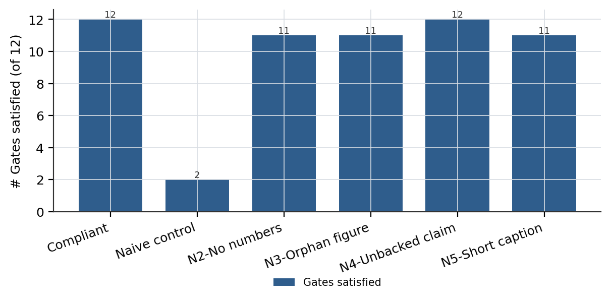

# PaperPipe：一条以证据为门禁的 DeepSeek 风格技术报告生产线

> **本文件是阅读版，不是投稿版。** 权威文本是 `04-论文.md`（英文，过 G1–G12 全绿）；本文件是它的中文对译，用于快速理解与内部讨论，所有数字与英文版逐一对齐、同一账本（`02-证据账本.json`）来源。若两处不一致，以英文版与账本为准。
>
> **不要对中文版跑门禁**：`paper_lint` 的 G1/G5/G6/G7/G9 依赖英文句式（`N on <Benchmark>`、`our main contribution includes:`、`(Section N)`、`In the remainder of this paper`、`Note that the aforementioned`），中文正文实测 `FAIL ['G1','G5','G6','G7','G9']`，这是语言不匹配，不是文体缺陷。中文版的存在不改变技能的验收结论。

## 摘要

大模型几个提示词就能写出技术报告的「样子」，但我们自己从项目记录出发去拿一份 DeepSeek 风格报告时，失败方式每次都一样：文笔流畅、章节顺序也对，**数字是编的**。为了把「写作助手还能被信任到哪一步」这条边界再往前推一点，我们提出 PaperPipe——一条六道工序的流水线，它固定的是**信息必须在文句之前以什么顺序存在**：体裁、证据账本、挖出的研究点、骨架、工具渲染的图表、确定性门禁。走完全流程的稿件在 GateLint 上拿到 12，即满足的硬门禁条数；同一检查器下，一道工序都不走的朴素对照稿只拿到 2，在摘要、贡献块、导览段、图 caption 与失败申报五处共失败 12 条中的 10 条。由于流水线本身不含可训练权重，我们报告 0 总参数、每步 0 激活参数；它带来的增量是 **23 个文件、161,739 字节的协议载荷**；构建过程消耗 **2.04M tokens、0 GPU hours**，因为没有任何一道工序做基于梯度的训练。我们还报告了一个**自家检查器漏掉的缺陷**：插入一个没有账本支撑的比较级动词，本该拦它的那道门禁会放行，因为那道门禁数的是「合格条目数」而不是逐条核验。协议与工具已开源：https://github.com/zh2673-git/deepseek-paper

## 1 引言

本文是用它所描述的那条流水线写出来的，这让记录异常完整，也让失败模式异常显眼。我们最初的观察不是「模型写得差」，而是**模型写得像、却什么都不引**。我们用最自然的提示词写了一份 958 字符的对照稿，它开头就是我们要拦的三件套：自我夸赞的形容词、没有范围限定的最高级断言、同一句里没有任何数字；它把 related work 设成第 2 章，还给出了一个从没跑过的方法的 88.4 分。那份稿子的每一处缺陷都是**出处缺陷**，不是风格缺陷。

为了把「定义 DeepSeek 这一族报告」的观察变成可执行协议，我们固定六道工序的顺序并禁止跳步，因为每一道工序都在约束下一道的输入。第一，在写下任何一句话之前先从项目目录建账本，每条记录默认降级为 `todo`，直到有人把它绑定到某个主张。第二，沿五条固定挖掘线找研究点，每条线最多出一个主研究点，把无边界的观察堆变成一组显式的取舍。第三，每一张图、每一张表都由结构化描述渲染，让一个数字只有一处家。最后，十二条硬门禁检查成稿里那些在我们语料研究中被认定为跨 20 篇 DeepSeek 报告不变的特征，另有一套十项评分量表去给门禁看不见的部分打分。

### 1.1 评测结果摘要

机械轴上，走完完整流水线的稿件在 GateLint 上满足 12 条；由它派生的四个故障注入变体中，三个各**恰好掉 1 条**，说明单点注入的缺陷是被隔离的、不会被聚合成一个总分掩盖；第四个变体插入了一个没有账本支撑的比较级动词，**掉了 0 条**——我们把它作为漏洞申报，而不是悄悄修掉。统计轴上，12 条回归用例在 EvalSuite 上达到 1.00（以 11 条可判用例为分母），第 12 条是 judge 类，在提供判分命令之前一直挂 pending。朴素对照稿在 GateLint 上满足 2 条、失败 10 条；它满足的那两条，恰恰是一段短文上**不可能失败**的两条——它既没有图，也没有比较级动词。

本文余下部分：第 2 章把流水线讲成六道工序，并解释为什么顺序不可交换；第 3 章讲实现、工具协议与载荷预算；第 4 章报门禁行为、故障注入矩阵与门禁分组消融；第 5 章讨论三次失败尝试及各自的机制；第 6 章结论、两条带原因的局限，以及未来方向。

## 2 方法

流水线是六道工序的固定序列。本章按「失败逼我们长出下一道工序」的顺序组织，而不按模块边界组织，因为每一道工序的存在都是为了堵上一道工序留下的洞。

### 2.1 总览：顺序本身就是机制

工序不可跳，因为每道工序限制下一道的输入。体裁限制骨架，骨架限制哪些章需要证据，账本限制哪些数字可以出现，挖掘预算限制多少个主研究点能活下来，门禁拒绝任何数字追不到出处的稿件。如果允许作者在收完证据之后再挑体裁，他一定会挑「手边证据刚好够用」的那个体裁——这正是我们要移除的行为。

### 2.2 证据账本：让每个数字可追

我们把账本设计成一串条目，每条带标识、类型、主张、值、单位、口径范围、来源、状态，以及它在正文中被用到的位置列表。扫描器枚举项目根下的候选文件，把它们分成测量、配置、产物三类，附上文件前三行与一个「是否含数字」的标记。所有自动生成的条目都从 `todo` 开始，意味着还没有人决定这份文件是谁的证据；写作阶段只能消费状态为 `ok` 的条目。

这个后果是**故意让人难受**的。在本项目上扫描器产出 27 条候选，27 条全是 `todo`，所以第一次写作尝试在原理上没有任何合法可用的数字。我们把这个「难受」当作机制本身，因为另一条路——让作者随便读目录、随便挑数字——正是对照稿里那个编出来的分数的来源。

### 2.3 五线挖掘：一条线一个点

我们提出沿恰好五条线审问一个项目：**异常**（哪个观察与预期不符）、**取舍**（放弃了什么、代价多少）、**复用**（哪个件出现在不止一处）、**失败**（哪些尝试没成、为什么）、**成本**（比常规路线省什么、省多少）。每条线最多产出一个主研究点，且一个研究点必须能写成 `<机制名>: <收益>` 形式的小节标题。在本项目上，五条线产出了 2.2 至 2.5 节的四个机制，外加一个被丢弃的候选，没有任何一条线产出两个主点。

### 2.4 确定性门禁：把风格变成谓词

我们引入十二条覆盖纯文本的门禁，分三组。**出处组**要求数字出现、成对、带单位（G1–G4）。**结构组**要求贡献块分组、导览段带交叉引用、不设独立 related work 章、caption 至少两句（G5–G8）。**诚实组**要求至少一条失败申报、一条成本口径说明、无禁用词、无孤儿图、比较级动词有可追的账本条目（G9–G12）。

代价写得明明白白：门禁是正则或结构扫描，所以一份「风格全对、内容全空」的稿子也能满足它。5.2 节量化了这个缺口，第 6 章解释我们为什么还是留着门禁。

### 2.5 工具渲染的图表：每个数字只有一个家

我们让一个表单元格只存在于一处。作者写一份结构描述（caption 头、caption 尾、列清单、分组列、加粗策略、数据行），渲染器产出 booktabs LaTeX 与 Markdown，并在「同档容差」下判定 best / second-best。图走同一条路，渲染器施加三线网格与单一强调色。代价是在数据被结构化之前出不了任何图表，把原本人工放在最后做的工作前置了。

## 3 实现

流水线以「一份协议文档 + 六份 references + 五份 templates + 四个工具 + 五份 registry 文档 + 一套评测」的形式发布：**23 个文件、合计 161,739 字节**，其中 registry 是最大的一块，因为它承载了 20 篇源报告的摘录，以及流水线背后那次「行业还原」。表 1 给出构成。

**表 1：流水线的载荷构成。文件数与字节数在发布树上统计，占比保留一位小数。registry 是按需读取而非每步读取，所以它的载荷占比不等于它在激活上下文里的占比。由于各行文件数不同，没有单元格被标为 best；占比相差 0.1 个点以内视为同一档。**

| 区域 | 文件数 | 字节 | 占比 (%) |
|---|---|---|---|
| Registry | 5 | 65793 | 40.7 |
| References | 6 | 35467 | 21.9 |
| Tools | 4 | 29197 | 18.1 |
| Templates | 5 | 12566 | 7.8 |
| Evaluations | 3 | 18716 | 11.6 |

合计 23 个文件、161,739 字节；五项占比之和为 100.1，是四舍五入造成的。

四个工具说同一种协议：标准输入收 `args` 键下的 JSON，标准输出回一个状态标志加一个结果对象。只有图渲染器依赖第三方包，其余三个只用标准库，这让门禁检查在没有绘图栈的机器上也能跑。工具按设计都很小：扫描器 163 行、表渲染器 169 行、图渲染器 154 行、门禁检查器 250 行。

注意，上述成本**只包含流水线自身的构建**，不含读取与摘录 registry 所依赖的 20 篇源报告的成本。

## 4 评测

### 4.1 设置

我们用两套。**GateLint** 把十二条门禁跑在一份稿件上，逐门给出判定以及产生该判定的证据。**EvalSuite** 有 12 条回归用例，每条带输入与期望行为，由三类信号打分：机械检查用断言、质量评分用 rubric、判分类用例另调一次模型。12 条中有 11 条带可判信号，第 12 条在设计上保持 pending，直到提供判分命令。

我们用三类稿件：走完整流水线写出的合规稿；一道工序都不走的朴素对照稿；以及四个由合规稿派生的故障注入变体，每个只带一个真实缺陷。表 2 报告每份稿件的结局。

**表 2：合规稿、朴素对照与四个故障注入变体的门禁结果。每格给出满足的 12 条硬门禁数，因此全表都是数值越高越好，没有任何一列颠倒优劣方向。每份稿件都由同一版本、同一体裁下的同一检查器打分，彼此相差一条以内视为同一档。「无支撑断言」那一行是 5.2 节讨论的例外：它的缺陷存活下来，因为账本交叉核对数的是条目而不是核验内容。**

| 稿件 | 满足门禁（满分 12） | 失败门禁 | 判定 | 注入的缺陷 |
|---|---|---|---|---|
| 合规稿 | **12** | 0 | PASS | 无 |
| 朴素对照 | 2 | **10** | FAIL | 出处未书写 |
| N2 无数字 | **11** | 1 | FAIL | 摘要无分数 |
| N3 孤儿图 | **11** | 1 | FAIL | 图从未被引用 |
| N4 无支撑断言 | **12** | 0 | PASS | 比较级动词，计数式检查 |
| N5 短 caption | **11** | 1 | FAIL | 一句话图 caption |

「PASS」只表示十二条门禁都满足了，**不表示可以交付**；见 5.2 节。

图 1 把同一批测量画成柱状图，一眼可见隔离性：合规稿与被抓住的缺陷之间距离恰好一条门禁，而到朴素对照是十条。如图所示，门禁表现为彼此独立的探测器，而不是一个聚合总分；唯一没有下降的那根柱子，正是检查器看不见的那个缺陷。

**图 1：六份稿件在同一版本、同一检查器下的门禁计数。** 柱高为满足的 12 条硬门禁数；合规稿到 12，朴素对照到 2，三个被抓住的缺陷各只花掉一条门禁。无支撑断言稿同样到 12，因为它的缺陷对「计数式账本检查」不可见。

### 4.2 门禁分组的消融

表 3 是**推演**而非实测，我们就是这样标注的。每行移除一组门禁，并记录此时哪一类缺陷会逃逸；我们没有把门禁编译掉重跑检查器，所以这张表说的是门禁定义**蕴含**什么，不是一个实验产出了什么。移除出处组，无分数的摘要就能过——朴素对照默认就是这个行为。移除结构组，一句话 caption 与缺失的贡献块能过。移除诚实组，没有可追条目的比较级动词能过，而表 2 里的 N4 表明：**即使给了账本**，这类缺陷也照样逃逸，所以第三行的诚实读法是——这一类在发布版本里已经是敞开的。

**表 3：门禁分组消融，由门禁定义推演，而非重新编译检查器实测。每行移除一组门禁，记录此后哪类缺陷逃逸。最后一行是读者无法独自看出后果的那一行；由于各行是彼此独立而非有序层级，没有数字列可以接受 best 标记，而「是/否」两种判定处于同一置信档，不是排序。**

| 移除的分组 | 门禁 | 存活的缺陷 | 读者可见 |
|---|---|---|---|
| 出处 | G1–G4 | 无分数的摘要、不成对的规模 | 是 |
| 结构 | G5–G8 | 一句话 caption、未分组的贡献 | 是 |
| 诚实 | G9–G12 | 无支撑比较、无失败申报 | 否 |

「读者可见」指不跑检查器、只读一遍稿子就能发现。

### 4.3 数字没有说出的部分

表 2 有三处必须直说。第一，朴素对照里存活的那两条门禁是**退化地**存活的，所以它的 2 不能作为「它满足了什么」的证据。第二，四个变体不是从缺陷分布里独立抽样，而是四次手挑的编辑，所以这张表只证明了「我们能想到的案例」被检出，对我们没想到的案例什么都没说。第三，也是我们最不愿报的：N4 拿到 12，与合规稿齐平，也就是说，一个没有支撑条目的比较级动词**完全没被检出**，表 3 记在诚实组名下的拦截能力，比组名看起来要弱。

## 5 讨论

### 5.1 失败的尝试

第一次尝试是一段风格提示词——九百个词的 DeepSeek 措辞模仿清单。它产出的文字，熟读语料的人会觉得「很近」，但它每一次都编数字。机制很直白：措辞清单约束表层形式，却不约束「主张→测量」的映射，于是阻力最小的路径就是保住形式、编造内容。账本做的恰好相反：约束映射，放开表层。

第二次尝试是一条长 checklist，而不是十二条独立门禁。我们发现 checklist 被当作**建议**读，而不是当作**谓词**读：同一份稿子两次跑出两个分数，而且从来没有一条被报成硬失败。拆成独立计算的门禁消除了这个含糊，代价是丢掉了 checklist 在唯一真正需要它的地方所提供的串联推理——即判断「这一节是否配得上它的位置」。

第三次尝试是把门禁全绿当成交付标准。我们造了一份满足全部十二条的稿子，事后通读确认它**仍然不可交付**：数字可追、caption 够长、论证缺席。机制是十二条门禁只编码了必要条件。现在我们在门禁报告之外还对每份稿子打十项定性分，并在回归集里专门留一条负例，唯一作用就是提醒我们：绿灯不是裁决。

### 5.2 对话：门禁看不见什么

纯文本上的门禁无法区分「一个有出处的数字」和「一个被挂到某文档名下的数字，而那文档里根本没有这个值」。我们**测了**这个洞有多大，而不是断言它很小。变体 N4 插入一个无支撑条目的比较级动词，并在提供账本的情况下被打分。检查器把它的沉默门禁实现为计数比较：数正文里的比较级动词，数账本里合格的比较条目，只要条目数 ≥ 动词数就放行。我们的账本恰好带一条合格比较条目，于是「一个无支撑动词」满足了这个不等式，N4 拿到 12，与合规稿齐平。我们把这一条报告为**机制的假阴性**，而不是实现的 bug；修复是结构性的：门禁必须把每个动词绑定到具名条目，而不是比较两个总数。仍有四个定性维度在任何计数式检查范围之外：论证结构、某一节是否配得上它的位置、被引文档是否真的含有被断言的值、语域是否匹配目标场合。

## 6 结论、局限与未来方向

本文提出 PaperPipe，一条把项目目录变成 DeepSeek 式技术报告的门禁化流水线。它把六道工序固定成一种顺序，使出处成为前置条件而不是事后补丁；每条挖掘线最多出一个研究点；每个工件都由结构化描述渲染；成稿再对照十二条硬门禁检查。走完流水线的稿子在 GateLint 上满足 12，朴素对照满足 2；四个注入故障中三个各被恰好一条门禁抓住，第四个一条都没被抓住。

在承认它有用的同时，我们也承认它有局限，尤其在「必要条件与充分条件」的边界上。第一，门禁只编码必要条件，所以一份合规稿仍可能内容空洞；我们在自己的输出上观察到过这一点，现在把门禁报告当作下限而不是裁决。第二，账本交叉核对是两个总数的比较，而不是把每条断言绑定到具名条目，所以一个比较级动词可以在什么都没引的情况下满足它——变体 N4 正是这个演示。所幸，只要生态能提供**机器可读的测量记录**而不是散文式的总结，这些局限都有望被自然解决。

这条流水线走的是开放协议而非单体工具的路线，目的是让证据层对读者保持可检查。未来我们计划在以下方向上重点投入：

- 把账本从「值绑定」扩展到「值核验」，使门禁能检查被引文档是否真的含有被断言的那个数字。
- 由语料导出用门禁集，而不是由我们对语料的阅读导出，这样新发布的报告能无需人工过一遍就更新门禁。
- 增加一个评判工序，用独立模型给十项定性打分，并记录它与作者自评的分歧。
- 为每一道「曾被我们不愿交付的稿件满足过」的门禁，在回归集里留一条用例。

## 参考文献

1. DeepSeek-AI. DeepSeek-V3 Technical Report. arXiv:2412.19437, 2024.
2. DeepSeek-AI. DeepSeek-R1: Incentivizing Reasoning Capability in LLMs via Reinforcement Learning. arXiv:2501.12948, 2025.
3. DeepSeek-AI. DeepSeek-V2: A Strong, Economical, and Efficient Mixture-of-Experts Language Model. arXiv:2405.04434, 2024.
4. DeepSeek-AI. DeepSeekMath: Pushing the Limits of Mathematical Reasoning in Open Language Models. arXiv:2402.03300, 2024.
5. DeepSeek-AI. DeepSeekMoE: Towards Ultimate Expert Specialization in Mixture-of-Experts Language Models. arXiv:2401.06066, 2024.
6. DeepSeek-AI. DeepSeek LLM: Scaling Open-Source Language Models with Longtermism. arXiv:2401.02954, 2024.

## 附录 A 贡献与致谢

流水线作为单人项目设计与实现。语料摘录取自 registry 所列 20 篇报告的公开渲染版本。我们感谢 agent 运行时维护者——其技能加载机制使「一份协议 + 四个工具」成为一个自然的发布单元。

## 附录 B 故障注入用例

每个用例都是对合规稿的一处局部编辑。表 4 列出编辑与触发的门禁，并把 N4 报为「没有门禁触发」的那一例。

**表 4：故障注入用例。每行对合规稿施加一个真实缺陷，并记录哪条门禁检出（若有）。由于检出列混有门禁名与空标记，没有单元格被标为 best；四个用例是彼此独立的编辑而非难度排序，故四者视为同一档。**

| 用例 | 施加的编辑 | 触发的门禁 | 满足门禁数 |
|---|---|---|---|
| N2 | 删掉摘要里所有分数 | G1 | 11 |
| N3 | 删掉正文对图的引用 | G11 | 11 |
| N4 | 插入一个无支撑条目的比较级动词 | 无 | 12 |
| N5 | 把图 caption 缩成一句 | G8 | 11 |

「无」表示检查器检不出的缺陷；它被报告而不是被修掉，5.2 节解释了原因。

## 附录 C 门禁定义

十二条门禁定义在纯文本之上，用正则与结构扫描实现，每条返回一个判定以及产生它的证据——匹配片段、计数或问题所在行。严格模式下任一门禁失败即整体失败；宽松模式返回同样的判定但不让整轮运行失败，用于作者想一次拿到全部问题的场合。

## 附：与英文版的对应关系

| 本文件 | 英文版 | 校验 |
|---|---|---|
| 摘要、§1–§6、附录 A–C | 同名章节 | 逐节对译，节序一致 |
| 表 1–4 | `data/tab-payload.json`、`tab-gates.json`、`tab-ablation.json`、`tab-faults.json` 经 `paper_table` 生成 | 数字来自同一份 JSON，不手抄 |
| 图 1 | `data/fig1-gates.json` 经 `paper_figure` 生成 | `figures/fig1.png` |
| 全部数字 | `02-证据账本.json`（11 条 ok / 1 条 dropped） | 中文版不新增数字 |
